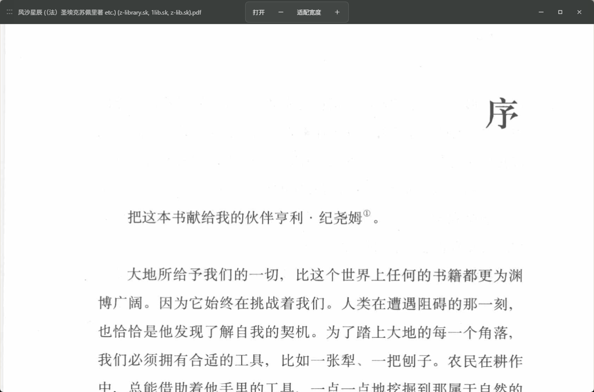
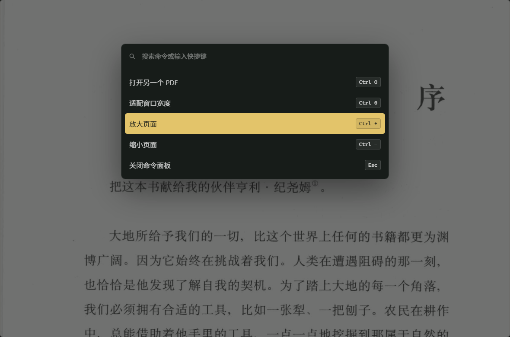

# Ashu PDF Reader

[English](README.md) | [简体中文](README.zh-CN.md)

[](https://github.com/Ashu-Lin/Ashu-PDF-Reader/releases)
[](LICENSE)
[](https://github.com/Ashu-Lin/Ashu-PDF-Reader/releases)
A minimalist, keyboard-first PDF reader for Windows.  
Built with Tauri 2, Vue 3, TypeScript, Vite, and PDF.js.



*Distraction-free reading view*



*Keyboard-first command palette (F1 / Ctrl+Shift+P)*

If this project fits the way you read, consider giving it a star to help more people find it.

Ashu PDF Reader is designed for people who want to read local PDF files without a crowded toolbar, a browser tab, or a heavy document suite. Launch it, choose a PDF, and the window becomes a quiet reader. Everything else stays out of the way until you ask for it.

## Why Ashu PDF Reader?

Most PDF viewers are full document platforms: tabs, sidebars, toolbars, account prompts, cloud features, update banners, and controls you rarely use. Ashu PDF Reader takes the opposite approach.

- Local-first: no account, no upload, no telemetry workflow.
- Minimal by default: after opening a PDF, only the document is visible.
- Keyboard-first: core actions are available without hunting through menus.
- Windows-first: built for a normal Windows desktop workflow.
- Frameless but familiar: the window can be moved, resized, minimized, maximized, and closed with familiar interactions.
- Fast to understand: launch, pick a PDF, read. Cancel and the app exits.

## Features

- Native Windows file picker on launch
- Cancel file selection to exit the app
- Single-window PDF reading
- PDF.js rendering
- Default fit-to-width mode
- Re-fit automatically when the window is resized
- Zoom in, zoom out, and reset to fit width
- `Ctrl + mouse wheel` zoom
- Hidden scrollbars with scroll and trackpad support
- Frameless Windows window
- Thin hover toolbar near the top edge
- `Alt + drag` to move the window from anywhere
- Edge and corner resize zones
- Keyboard-first command palette
- Original app icon
- Release installers without a terminal window

## Keyboard Shortcuts

| Action | Shortcut |
| --- | --- |
| Open another PDF | `Ctrl+O` |
| Fit width | `Ctrl+0` |
| Zoom in | `Ctrl+=`, `Ctrl++`, or `Ctrl+Mouse Wheel Up` |
| Zoom out | `Ctrl+-`, `Ctrl+_`, or `Ctrl+Mouse Wheel Down` |
| Command palette | `F1` or `Ctrl+Shift+P` |
| Close overlay | `Esc` |
| Move window | `Alt + Drag` |
| Resize window | Drag edges or corners |

## UX Principles

Ashu PDF Reader follows a simple rule: the document is the interface.

- No permanent toolbar.
- No default menu bar.
- No visible scrollbar clutter.
- No side gutters in fit-width mode.
- Controls appear only when needed.
- The hover toolbar stays thin and quiet.
- The command palette keeps optional features discoverable without permanent UI.

## Tech Stack

- Tauri 2
- Vue 3
- TypeScript
- Vite
- PDF.js (`pdfjs-dist`)
- Rust
- pnpm

## Getting Started

### Requirements

- Node.js 20+
- pnpm
- Rust stable
- Windows WebView2

### Install dependencies

```powershell
pnpm install
```

### Run in development

```powershell
pnpm tauri dev
```

### Build the frontend

```powershell
pnpm build
```

### Build Windows installers

```powershell
pnpm tauri build
```

Release installers are generated under:

```text
src-tauri/target/release/bundle/
```

## Project Structure

```text
.
├─ assets/                  # Source app icon
├─ design/                  # UI prototype, project book, TODO
├─ docs/                    # Architecture and feature documentation
├─ src/
│  ├─ components/
│  │  ├─ reader/            # PDF rendering surface
│  │  ├─ ui/                # Command palette
│  │  └─ window/            # Hover toolbar and resize handles
│  ├─ composables/          # PDF, keyboard, and window logic
│  └─ types/                # Shared TypeScript types
├─ src-tauri/               # Tauri/Rust backend
├─ AGENTS.md                # AI collaboration instructions
├─ CHANGELOG.md             # Version history
└─ README.zh-CN.md          # 中文说明
```

## Roadmap

- PDF search
- Table of contents sidebar
- Recent files
- Reading progress
- Theme options
- GitHub release download page
- Optional auto-update

## Search Keywords

minimal PDF reader, lightweight PDF viewer, Windows PDF reader, Tauri PDF reader, Tauri 2 app, Vue 3 PDF viewer, TypeScript PDF reader, PDF.js desktop app, keyboard-first PDF reader, distraction-free PDF reader, open source PDF viewer, frameless PDF reader, local-first PDF reader.

## License

MIT


